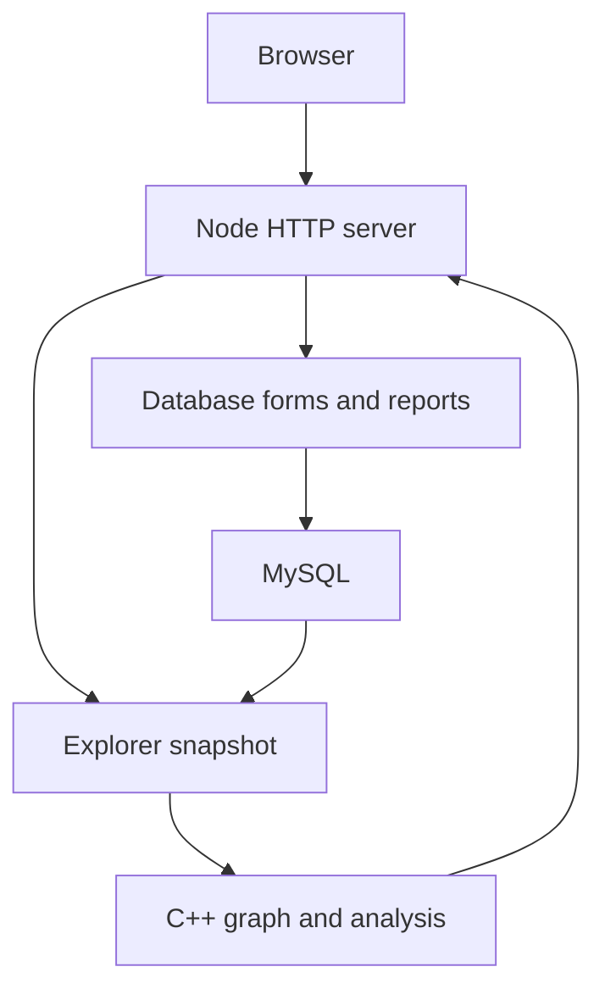
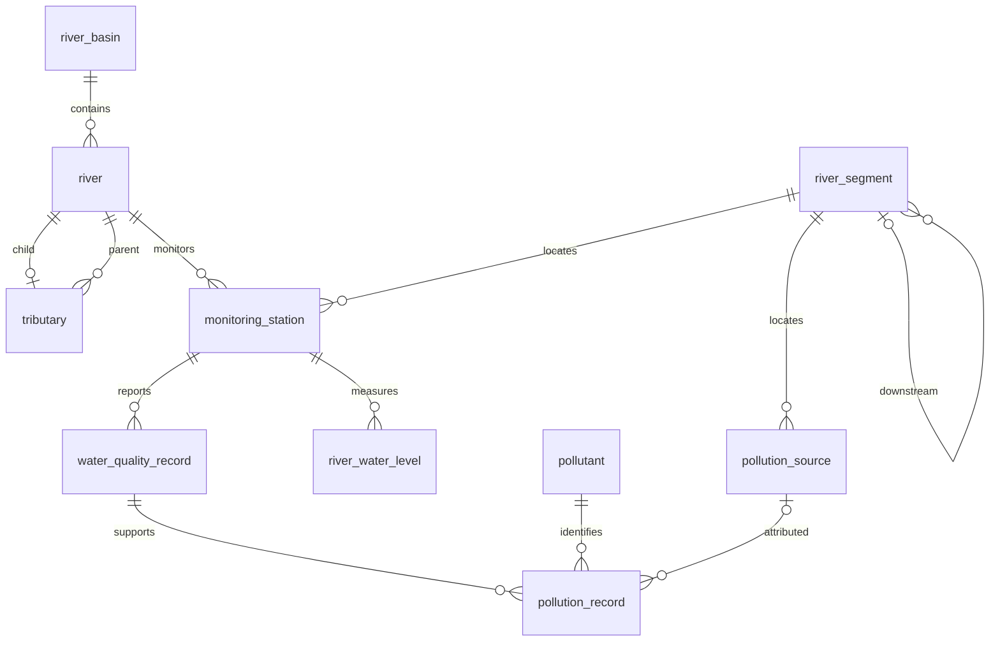
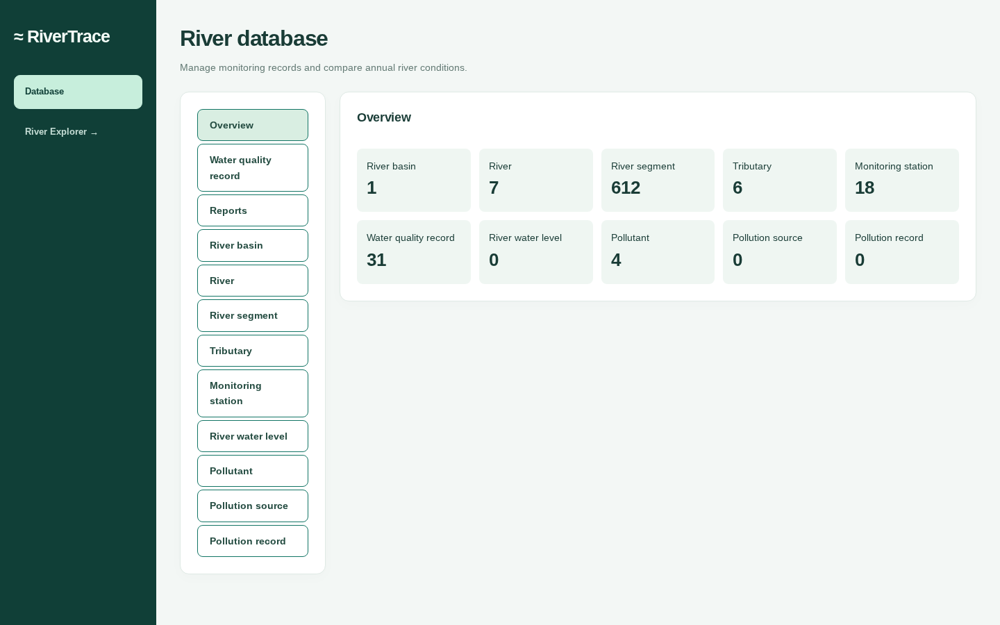
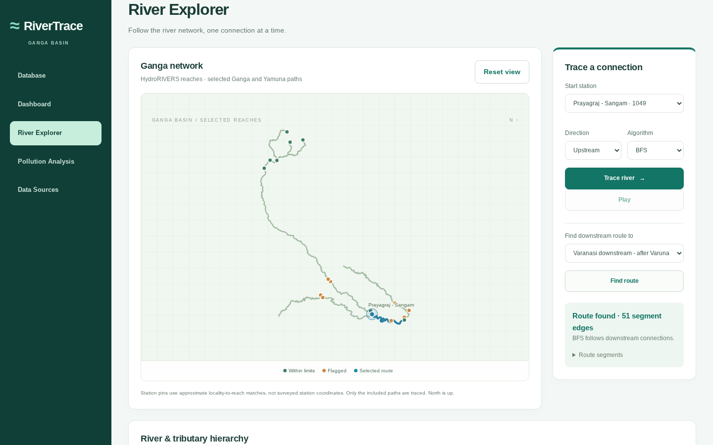

## Upgrade an existing RiverTrace database
For your existing rivertrace_v2 installation, connect as your MySQL administrator, run `use rivertrace_v2;`, then source database/procedures.sql, database/cursors.sql and database/triggers.sql in that order. Give each source command the full extracted path. Keep your existing .env privately in the new project folder, install dependencies and build as below. Skip schema creation and seeding for this upgrade.

The Reports page calls four MySQL stored procedures. For a SQL demonstration, run database/queries.sql and compare its results with the website. To inspect one station across years, run these read-only cursor routines:
```sql
call observation_gaps('1049');
call status_changes('1049');
call flag_streak('1049');
```
Gaps count only years between two reported years. Changes compare adjacent calendar years. A missing year breaks a flagged streak. Trigger definitions cover edit history, tributary cycles and observation evidence on insert and update.

# RiverTrace · MySQL edition

A local database workspace for the Ganga pilot, with the original C++17 River Explorer. The supplied files contain **7 named rivers, 6 tributary relationships, 612 reaches, 18 stations and 31 annual records** for 2022–2023. Water levels, pollution sources and pollution observations start empty. Four parameter definitions are seeded.

## Run on Windows

Install MySQL Community Server 8.4 with MySQL Workbench or the mysql command-line client, Node.js 22.9 or newer, CMake and MinGW-w64 with g++ and mingw32-make. Start the MySQL service. Extract the ZIP and open the folder containing package.json in VS Code.

1. In Workbench, connect to your local MySQL server as a database administrator. Create a new database and local account. Choose your own password in place of the placeholder. Use an unused database name if you already have one called rivertrace.

```sql
create database rivertrace character set utf8mb4;
create user 'rivertrace_app'@'localhost' identified by 'choose_your_own_password';
grant select, insert, update, delete, execute on rivertrace.* to 'rivertrace_app'@'localhost';
```

Still in Workbench as the administrator, select the new database as the default schema (double-click its name). Run **database/schema.sql**, **database/procedures.sql**, **database/cursors.sql** and **database/triggers.sql**, in that order. This creates the triggers using an account with the required privileges. The application uses its own account for day-to-day reads and writes.

2. In the VS Code PowerShell terminal, install dependencies and make a local configuration file.

```powershell
npm ci
Copy-Item .env.example .env
```

Edit .env to match the database, port, username and password you chose. Use quotes around a password containing a # character. The website binds to 127.0.0.1.

3. Load the historical data into the new tables.

```powershell
npm run seed
```

The seed script uses one transaction. A duplicate key or invalid source row rolls the import back. For a terminal-only setup, an administrator can run npm run schema with configuration for an empty database, then switch to the local application account before seeding. Use either Workbench or the installer for schema creation. MySQL commits DDL statement by statement. If setup fails partway, inspect the error and choose a new empty database for a clean retry.

4. Build and start from the project root.

```powershell
cmake -S . -B build -G "MinGW Makefiles"
cmake --build build -j 2
npm start
```

Open http://127.0.0.1:8080. Keep the terminal running. On later runs, start MySQL and run npm start. Rebuild after C++ changes. The database workspace works without the explorer executable. A missing executable produces a build instruction when opening the explorer.

**Linux** uses the same MySQL and Node setup. Copy the configuration with `cp .env.example .env`. Build with `cmake -S . -B build` and `cmake --build build -j 2`, then run `npm start`.

## How the parts connect



The database workspace sends form values to Node. Table and column names come from the server's allowlist. Values go into mysql2 prepared statements. Reports execute the actual statements in database/reports.sql. Each explorer request reads a repeatable-read MySQL snapshot, writes loader-compatible files into a private temporary directory and runs the compiled C++ program there. Node removes the directory in a finally block. The original data folder is used for seeding and standalone DS demonstrations. The integrated map reads the original GeoJSON features from MySQL.

## Tables and relationships



A tributary row has a unique child and a parent. Each hierarchy write through the application locks the river rows before the cycle triggers follow the parent chain. The C++ hierarchy supports separate roots when a new river is entered. Segment connectivity is independent of river names. Unnamed HydroRIVERS reaches retain their original IDs and geometry. A null downstream ID marks the boundary of the included subset. The original downstream ID remains in the geometry feature.

Each station/year has one quality row. DO and BOD use mg/L, pH is unitless and faecal coliform uses MPN/100 mL. Range checks require two valid endpoints or two nulls. The joined view checks violations first, then completeness. Project flag limits are BOD maximum ≥ 3, DO minimum ≤ 5, pH outside 6.5–8.5 or FC maximum ≥ 2500. The annual extremes can come from different dates. A flag is a prompt for review. An observation requires a source reference, and linking a pollution source requires evidence. Connectivity alone cannot establish cause or travel time.

Parent deletion is restricted by default. Deleting a quality row explicitly deletes its linked pollution observations in the same transaction. Its JSON edit history also disappears. Updating the row appends the previous values and UTC timestamp via a trigger. If a related operation fails, the transaction rolls back. Water levels are entered in metres with a reference datum and source. Station mapping is approximate. See [data sources, BDL qualifiers and mapping limitations](data/README.md) and [attribution](data/licenses/ATTRIBUTION.txt).

## Demo for faculty

1. Open the database overview. Review the imported counts and the empty observation tables.
2. Open Water quality record, filter year 2022 and search 1491. Gangotri's BOD and coliform pairs are missing numerically; its notes preserve the below-detection qualifier.
3. Open Reports. Flagged stations for 2023 returns nine rows. Missing records for 2022 returns five stations. Year comparison puts each station's annual extremes beside the previous year's values if available.
4. To demonstrate writes, use a disposable local copy. Try a duplicate station/year, then try a reversed range. Edit a record's notes and open History to inspect the previous values. Delete confirmation describes the consequences.
5. Open River Explorer. Trace upstream from Sangam (1049) using BFS and DFS. Play and pause the traversal. Find the downstream route to 1071, then reverse it. BFS searches in fewest segment links. DFS explores a branch in depth. Both use O(V + E) traversal time and O(V) extra space.
6. In Workbench, run database/queries.sql. The report calls in database/reports.sql use ? placeholders supplied by Node. Replace a placeholder with 2023 when running that statement directly in Workbench.

## Files and team interfaces

| Owner | Files | Work and checks |
|---|---|---|
| C++ and DS | src/, CMakeLists.txt | Maintain adjacency lists, BFS/DFS, shortest-hop route, hash lookups, station history, heap ranking and hierarchy. Check visited sets, directions and disconnected roots. |
| Database and data | database/schema.sql, setup.js, seed.js, reports.sql, lookups.sql, data/ | Verify keys, constraints, imports, status rules, attribution and report results. |
| Server and integration | server.js, database/connection.js, entities.js, workspace.js, explorer.js | Maintain prepared statements, transactions, entity validation and isolated snapshots. Compare C++ results with SQL reports. |
| Frontend and presentation | web/workspace.*, web/index.html, web/app.js, web/style.css, README.md | Maintain database forms, reports, error states and explorer controls. Demonstrate the end-to-end workflow. |

The original explorer uses /api/trace, /api/path and the other /api routes. The new workspace uses /db/catalog for editable fields and foreign-key choices, /db/overview for counts, /db/{table} for browsing and adding rows, /db/{table}/{id} for edits/deletes, and /db/report/{report_name} for SQL reports. Management of river segments is read-only. /network.geojson serves the stored geometry.

For collaboration, use small branches such as feature/quality-reports or feature/station-forms. Agree on column and JSON names before working in parallel. Open one pull request per working feature, include its input and expected result, and have someone from the adjoining workstream review it. Keep local credentials, generated binaries and node_modules out of Git.


## Validation

Built C++17 with CMake and g++ on Linux. On MySQL Community Server 8.4.9, verified import counts, SQL/C++ flagged-station agreement for both years, all four reports, range and foreign-key checks, cycle rejection, edit history, rollback and transactional dependent deletion. A changed record appeared in the C++ explorer. Concurrent BFS and DFS requests returned the same upstream set. The downstream route succeeded from 1049 to 1071 and the reverse route returned no path.

Headless Chromium checks covered the overview, filtered records, history dialog, basin add/edit/delete, reports, river trace, Play/Pause and route finding. Windows/MinGW setup is documented and has not been run in this environment.




